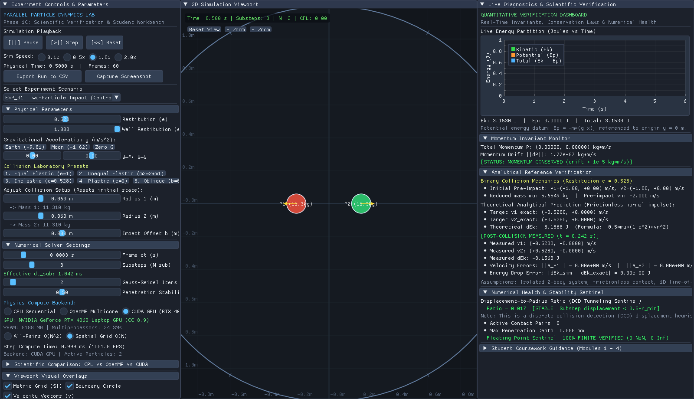

# Parallel Particle Dynamics Lab

A C++17 2D particle-dynamics workbench for comparing a sequential CPU solver, an OpenMP solver, and an optional NVIDIA CUDA solver under shared simulation scenarios.

The project is a **portfolio-ready engineering prototype**. It demonstrates collision mechanics, first-order integration, spatial broad-phase acceleration, parallel implementation strategies, diagnostics, and CSV export. It is not presented as a research-grade or general-purpose physics engine.

[](LICENSE)
[](CMakeLists.txt)
[](RELEASE_NOTES.md)



## Project overview

- Shared C++17 particle state, configuration, contact, boundary, and diagnostics code.
- Sequential CPU contact resolution using in-place Gauss-Seidel-style updates.
- OpenMP shared-memory execution using thread-local Jacobi-style accumulation.
- Optional CUDA execution using double-buffered Jacobi-style updates and a GPU spatial grid.
- Semi-implicit Euler and explicit Euler integration for comparison.
- Frictionless elastic and inelastic impacts with a coefficient of restitution.
- Circular boundary response, gravity, penetration correction, and finite-state checks.
- Uniform-grid broad-phase collision candidate generation.
- GLFW, Dear ImGui, ImPlot, and OpenGL desktop workbench.
- Headless experiments, CSV export, plots, and automated tests.

The CPU, OpenMP, and CUDA contact algorithms are not bitwise identical for dense simultaneous contacts. Verification checks analytical cases and bounded aggregate behavior rather than claiming identical many-body trajectories.

## Model summary

For contact normal $\mathbf{n}$, relative normal speed $v_n$, coefficient of restitution $e$, and inverse masses $m_1^{-1}$ and $m_2^{-1}$, the normal impulse is

$$
j = -\frac{(1+e)v_n}{m_1^{-1}+m_2^{-1}}.
$$

The default integrator is semi-implicit Euler:

$$
\mathbf{v}_{n+1}=\mathbf{v}_n+\mathbf{g}\,\Delta t,
\qquad
\mathbf{x}_{n+1}=\mathbf{x}_n+\mathbf{v}_{n+1}\,\Delta t.
$$

The included constant-acceleration refinement experiment confirms the expected first-order trend for that tested problem. This is verification of the implementation, not a blanket accuracy claim for arbitrary simulations.

## Repository layout

| Path | Purpose |
|---|---|
| `sim_core/` | Shared types, diagnostics, contact/boundary logic, and sequential solver |
| `sim_omp_v2/` | OpenMP solver, spatial grid, and CPU benchmarks |
| `sim_cuda_v2/` | Optional CUDA solver, GPU spatial grid, and cross-backend benchmark |
| `lab_gui/` | Interactive desktop workbench |
| `experiments/` | Collision, gravity, convergence, export, and audit runners |
| `tests/` | Physics, OpenMP, CUDA, grid, GUI, and cross-backend checks |
| `docs/` | Design notes, coursework, verification records, and release handoff |
| `output/` | Example CSV data, plots, and application screenshots |

## Requirements

### CPU/OpenMP

Verified on Ubuntu 24.04 under WSL2/WSLg with CMake 3.28.3, GCC 13.3, C++17, OpenMP 4.5, OpenGL 3.3, and X11.

```bash
sudo apt update
sudo apt install -y build-essential cmake git libgl1-mesa-dev xorg-dev
```

The GUI configuration fetches pinned GLFW, Dear ImGui, and ImPlot sources from GitHub, so the first configure requires network access. A display server is required only for the interactive window.

### Optional CUDA

The verified CUDA environment used CUDA Toolkit 12.0 and an NVIDIA GeForce RTX 4060 Laptop GPU. The current CMake configuration targets compute capability **8.9 (`sm_89`)**. Other toolkit versions and GPU architectures have not been release-verified.

If CUDA is unavailable, configure with `-DENABLE_CUDA=OFF`.

## Build

CPU/OpenMP desktop application:

```bash
cmake -S . -B build -DCMAKE_BUILD_TYPE=Release -DENABLE_CUDA=OFF
cmake --build build -j8
```

CPU/OpenMP command-line tools only:

```bash
cmake -S . -B build_cpu -DCMAKE_BUILD_TYPE=Release \
  -DENABLE_CUDA=OFF -DBUILD_LAB_GUI=OFF
cmake --build build_cpu -j8
```

CUDA-enabled desktop application on compatible hardware:

```bash
cmake -S . -B build -DCMAKE_BUILD_TYPE=Release -DENABLE_CUDA=ON
cmake --build build -j8
```

## Demonstration guide

```bash
# Run every test registered for the configured backends
ctest --test-dir build --output-on-failure

# Launch the desktop workbench
./build/sim_lab

# Exercise the GUI simulation path without opening a window
./build/sim_lab --test-headless 60

# Generate collision, gravity, and convergence CSV files
./build/run_experiments --out output/csv
```

Suggested two-minute walkthrough:

1. Open `sim_lab` and select the two-particle collision experiment.
2. Change restitution from `1.0` to `0.5` and compare momentum and kinetic-energy diagnostics.
3. Switch between CPU and OpenMP; select CUDA only on compatible hardware.
4. Open the dense granular preset to show spatial-grid contact handling.
5. Run `ctest` and show the exported CSV files in `output/csv/`.

## Verification snapshot

Fresh verification on **November 1, 2026** produced:

| Configuration | Result | Scope |
|---|---:|---|
| CUDA-enabled release build | 10/10 CTest suites passed | CPU, OpenMP, CUDA, grids, GUI smoke, numerical audit |
| CPU/OpenMP desktop build (`ENABLE_CUDA=OFF`) | 7/7 CTest suites passed | CPU, OpenMP, grid, GUI smoke, numerical audit |
| CPU/OpenMP CLI-only build | 6/6 CTest suites passed | CPU, OpenMP, grid, experiments, numerical audit |

Representative executable checks also passed:

- Core physics: 14/14, including constant velocity, gravity, integration order, finite-state guards, and elastic/inelastic collisions.
- Collision acceptance: 7/7 analytical and model-specific cases.
- OpenMP: 46/46 checks across 1, 2, 4, 8, and 16 threads.
- CUDA: 10/10 checks on the verified RTX 4060 environment.
- Cross-backend: 4/4 scenarios.
- Export smoke test: five non-empty CSV files generated successfully.

The checked-in benchmark CSV files and plots are historical measurements from the documented machine. They are useful as reproducibility artifacts, but no universal GPU speedup or throughput claim is made here.

## Screenshots and example output

Eight genuine tracked 1600x920 application captures are in [`output/screenshots/`](output/screenshots/), including collision, gravity, convergence, dense-contact, OpenMP, and CUDA views. Example CSV files and plots are under [`output/csv/`](output/csv/) and [`output/plots/`](output/plots/).

## Known limitations

- The model is 2D, uses circular particles, and implements frictionless normal contact without rotational dynamics.
- Collision detection is discrete. Large motion per substep can tunnel through contacts.
- Dense-contact trajectories differ across sequential Gauss-Seidel and parallel Jacobi update schemes.
- CUDA release verification is limited to `sm_89` hardware.
- Performance depends on workload, compiler, thermal state, and hardware. Re-run benchmarks before quoting results.
- Interactive GUI verification is Linux/WSLg-focused; native Windows and macOS builds are not release-verified.
- In the November 1 WSLg audit, unattended `--screenshot` commands returned blank frames even though the existing tracked captures are valid. Visually inspect any new capture.
- This is an educational and portfolio prototype, not a safety-critical or research-validated simulator.

## Documentation and license

- [Release notes](RELEASE_NOTES.md)
- [Publication and career handoff](docs/release/PUBLICATION_HANDOFF.md)
- [Experiment guide](docs/experiments/EXPERIMENT_GUIDE.md)
- [Known limitations](docs/verification/KNOWN_LIMITATIONS.md)

The project is distributed under the [MIT License](LICENSE). Third-party notices for GLFW, Dear ImGui, ImPlot, and `stb_image_write` are included in the license file.
