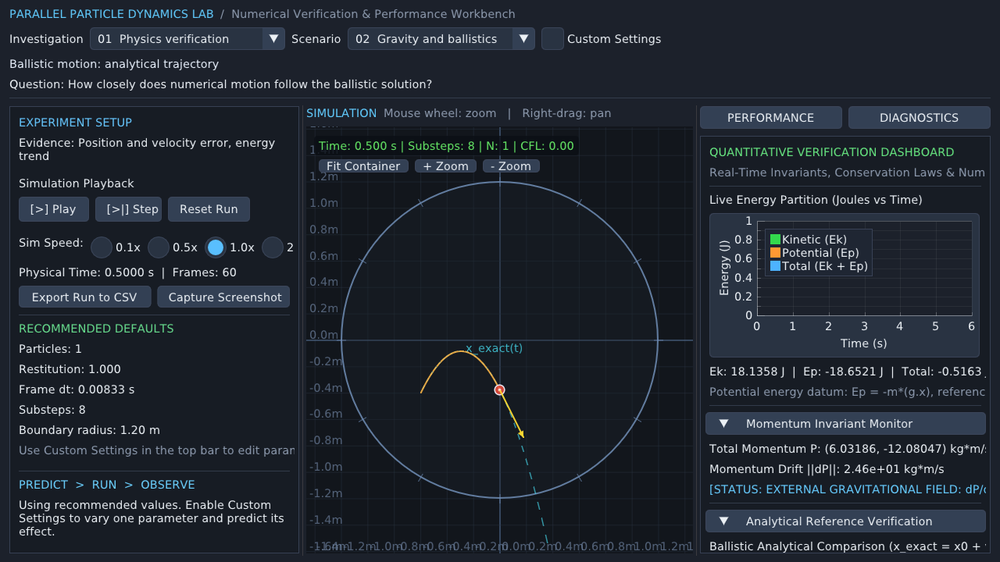
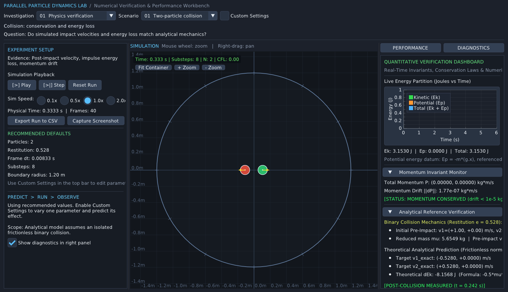
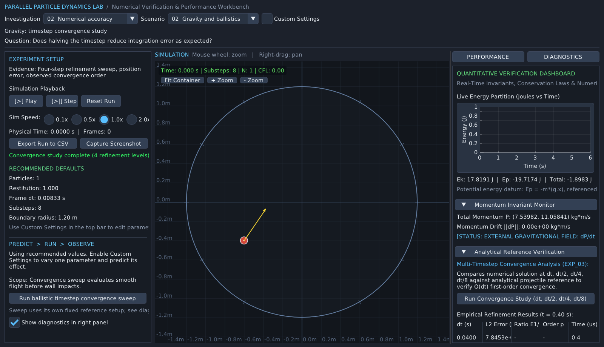
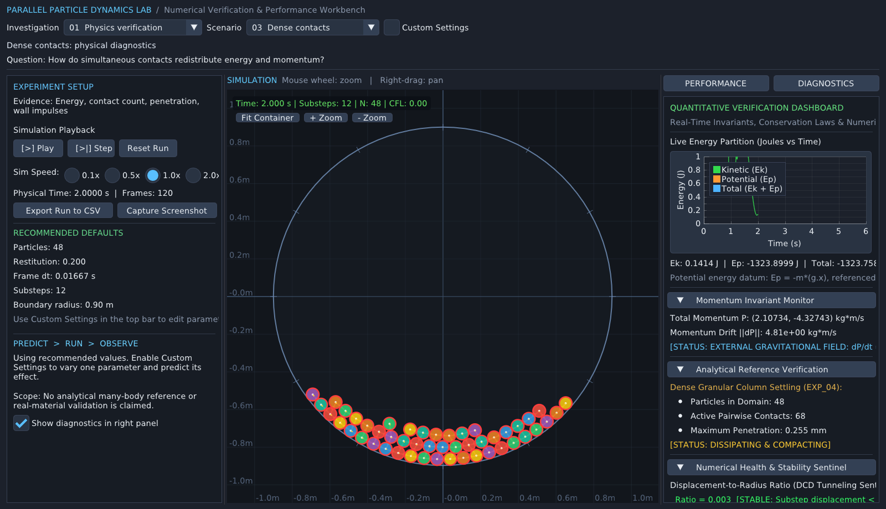
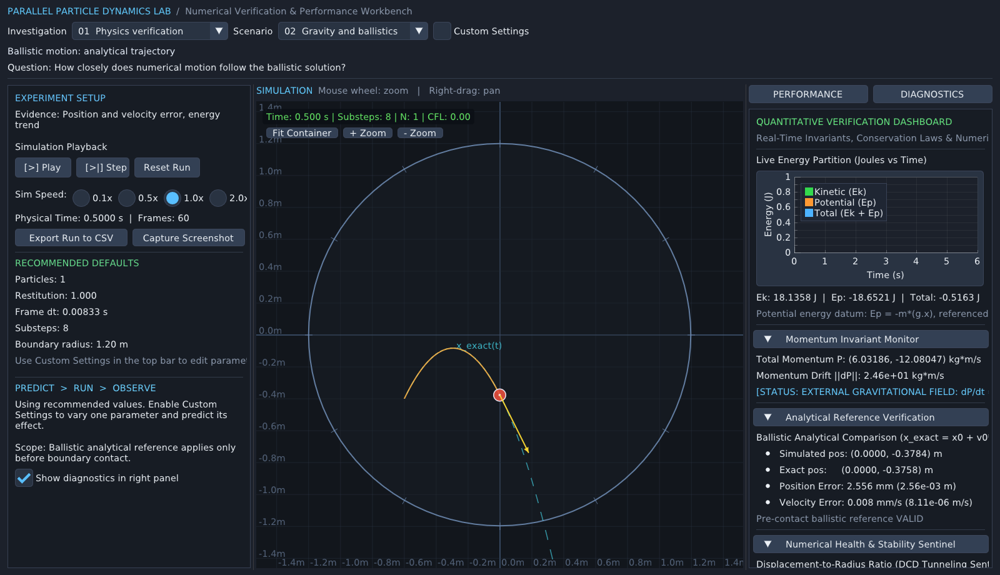

# Parallel Particle Dynamics Lab

[](https://github.com/Devansh-Mishra-30/Parallel-Particle-Dynamics-Lab/actions/workflows/ci.yml)


A C++17 numerical simulation and HPC workbench for studying 2D particle dynamics with sequential CPU, OpenMP, and NVIDIA CUDA implementations. Its native ImGui/ImPlot interface connects physical predictions, numerical errors, contact resolution, and computational cost.

**Engineering question:** How do physical assumptions, timestep size, contact resolution, and backend design trade accuracy, stability, and compute cost? The lab starts with analytical cases where error is measurable, then moves to dense contacts and scaling workloads where results depend on both the numerical method and its implementation.

**Verified highlights (November 2026):** first-order convergence (observed order ≈ 1.00); controlled 48-particle contact-resolution study; four-size CPU/OpenMP/CUDA scaling study; 14/14 local CUDA-enabled CTest suites passed. See the [scientific audit](docs/audit/STAGE_4_VERIFICATION_REPORT.md) and [preserved results](output/audit/stage4_preserved_2026-11-06_Ku9qXI/). These are results for the documented configurations, not general guarantees of accuracy or speedup.

## Visual Showcase

<p align="center">
  <strong>Computational Physics · Numerical Methods · High-Performance Computing</strong>
  <br>
  <sub>CPU · OpenMP · NVIDIA CUDA · C++17 · Dear ImGui / ImPlot</sub>
</p>

<p align="center">
  <a href="output/audit/stage4_preserved_2026-11-06_Ku9qXI/gui/gravity_1280x720.png">
    
  </a>
</p>

<p align="center">
  <sub>
    Native scientific workbench: simulated particle trajectories
    compared against analytical physics references.
  </sub>
</p>

### Physics, Accuracy, and Contact Dynamics

<table>
<tr>
<td width="33%" align="center">
  <a href="output/audit/stage4_preserved_2026-11-06_Ku9qXI/gui/collision.png">
    
  </a>
  <br>
  <strong>Collision Physics</strong>
</td>

<td width="33%" align="center">
  <a href="output/audit/stage4_preserved_2026-11-06_Ku9qXI/gui/convergence.png">
    
  </a>
  <br>
  <strong>Numerical Convergence</strong>
</td>

<td width="33%" align="center">
  <a href="output/audit/stage4_preserved_2026-11-06_Ku9qXI/gui/granular.png">
    
  </a>
  <br>
  <strong>Dense Contact Dynamics</strong>
</td>
</tr>
</table>

> **Figure provenance:** These screenshots are from the preserved
> November 2026 Stage 4 scientific workbench verification.
> They represent the documented simulation configurations,
> not an assertion of identical trajectories across different solvers.

### Explore the Project

**[Portfolio Case Study](https://devanshportfolio.bubbleapps.io/version-test/project-10)**
&nbsp; | &nbsp;
**[Scientific Verification Report](docs/audit/STAGE_4_VERIFICATION_REPORT.md)**
&nbsp; | &nbsp;
**[Reproducible Evidence](output/audit/stage4_preserved_2026-11-06_Ku9qXI/)**
&nbsp; | &nbsp;
**[GitHub Actions](https://github.com/Devansh-Mishra-30/Parallel-Particle-Dynamics-Lab/actions)**

### Engineering Highlights

| Area | Verified implementation or result |
| --- | --- |
| **Physics** | 2D frictionless particle dynamics with gravity and restitution |
| **Numerical integration** | Semi-implicit Euler with timestep refinement studies |
| **Parallel computing** | Sequential CPU, OpenMP, and NVIDIA CUDA |
| **Numerical convergence** | Approximately first-order in the documented ballistic study |
| **Performance study** | Four particle-count workloads with CPU/OpenMP/CUDA comparisons |
| **Local CUDA verification** | 14/14 CTest suites passed |
| **Hosted CPU/OpenMP verification** | 10/10 headless and 11/11 GUI-enabled tests passed |
| **Scientific workbench** | Dear ImGui and ImPlot interface |

Performance measurements are specific to the documented hardware,
solver configuration, and workload. They should not be interpreted
as general speedup guarantees.

---

## Physics and numerical methods

The model uses circular particles with translational motion, uniform gravity, frictionless normal impacts, and a circular wall. Restitution controls the normal rebound. For an approaching isolated pair, the normal impulse magnitude is `j = -(1 + e) vₙ / (1/m₁ + 1/m₂)` under the solver's sign convention. The impulse changes velocity. A separate position correction reduces residual overlap in discrete steps.

The default semi-implicit Euler method updates velocity before advancing position. Explicit Euler uses the previous velocity for the position update. Each frame can be split into substeps, with iterative contact resolution inside the substeps. Smaller substeps can improve resolution, and additional contact iterations can reduce overlap at increased cost. The measured response depends on the configuration.

## Architecture

| Component | Role |
| --- | --- |
| [`sim_core/`](sim_core/) | Shared particle types, integration, contacts, boundary handling, and diagnostics. The sequential reference solver uses all-pairs candidate search and in-place Gauss–Seidel-style contact updates. |
| [`sim_omp_v2/`](sim_omp_v2/) | Multicore solver with a uniform-grid broad phase and Jacobi-style accumulation using thread-local buffers. |
| [`sim_cuda_v2/`](sim_cuda_v2/) | GPU solver with a device spatial grid and double-buffered Jacobi-style updates. |
| [`lab_gui/`](lab_gui/) | Native GLFW, Dear ImGui and ImPlot workbench with independent investigation and scenario selectors. |
| [`experiments/`](experiments/) and [`tests/`](tests/) | Standalone numerical experiments, analytical checks, backend regressions, and an end-to-end Workbench verifier. |

The scaling study selects the grid for OpenMP and CUDA. A grid prunes candidate pairs in favorable distributions, while work can still increase sharply when many particles occupy the same neighborhood. In dense contacts, the reference solver can consume earlier updates within an iteration, while the parallel methods accumulate updates from an iteration snapshot.

## Scientific investigations

| Mode | Example experiment | What to compare |
| --- | --- | --- |
| Physics verification | Two-particle collision or Gravity and ballistics | Post-impact velocity and energy change, or trajectory error before wall contact |
| Numerical accuracy | Ballistic timestep sweep or Dense contacts | Empirical convergence order, residual and peak overlap, and cost per frame |
| HPC performance | Particle cloud scaling | Median milliseconds per step, speedup relative to the CPU reference, and state diagnostics |

Select a scenario, start with the recommended defaults, and use **Custom Settings** to vary parameters. Choose **Numerical accuracy → Gravity and ballistics** for the fixed-reference timestep sweep, **Numerical accuracy → Dense contacts** for the controlled contact study, or **HPC performance → Particle cloud** for backend scaling.

## Verification evidence

The Stage 4 audit compared isolated collisions and free flight against analytical reference solutions, held the initial snapshot and physical horizon fixed for the contact study, checked all 15 investigation/scenario combinations, and parsed exported CSVs. It recorded 14 passing CTest suites on the CUDA desktop build. [Stage 4 report](docs/audit/STAGE_4_VERIFICATION_REPORT.md)

### Collision and gravity

The two collision runs used the same initial geometry, masses, velocities, timestep and boundary, with restitution varied between cases. Measurements were taken at the first reported collision impulse. The wall was outside the interaction region.

| Restitution | Measured kinetic energy change (J) | Analytical change (J) | Max velocity error (m/s) | Momentum drift (kg·m/s) |
| ---: | ---: | ---: | ---: | ---: |
| 0.528 | −8.156761169 | −8.156761169 | 0 at recorded precision | 1.77 × 10⁻⁷ |
| 0.800 | −4.071505070 | −4.071503639 | 0 at recorded precision | 4.14 × 10⁻⁷ |

In the ballistic cases, the free-flight position and velocity were compared at 0.300 s using eight substeps per 1/120 s frame. Under constant acceleration, the expected semi-implicit Euler position-error magnitude is approximately `0.5 |g| t h`, where `h` is the substep. Once the numerical state departs from the corresponding unconstrained step due to the wall, the free-flight error is marked unavailable.

| Gravity y (m/s²) | Measured position error (m) | Expected Euler error (m) | Velocity error (m/s) | First detected boundary interaction (s) |
| ---: | ---: | ---: | ---: | ---: |
| −9.80665 | 0.001533182 | 0.001532289 | 3.96 × 10⁻⁶ | 0.7250 |
| −3.70000 | 0.000581253 | 0.000578125 | 1.22 × 10⁻⁵ | 1.3833 |

### First-order timestep convergence

Halving the timestep approximately halved the position error for this smooth ballistic reference. The observed order follows `p = log(E_coarse/E_fine) / log(h_coarse/h_fine)`.

| Timestep (s) | L2 position error (m) | Error reduction | Empirical order |
| ---: | ---: | ---: | ---: |
| 0.040 | 0.078453183 | — | — |
| 0.020 | 0.039226547 | 2.000002 | 1.000002 |
| 0.010 | 0.019613251 | 2.000002 | 1.000002 |
| 0.005 | 0.009806395 | 2.000047 | 1.000034 |

### Dense-contact sensitivity

The CPU study used the same 48-particle snapshot and 180 frames (approximately 3 s) in all cases. Each run stayed finite. At fixed substep count, more iterations lowered final overlap in this scene and increased time per frame. The 12-substep, eight-iteration case had the lowest peak overlap and the highest measured cost. Overlap measures numerical contact resolution in this model.

| Substeps | Iterations | Final max penetration (mm) | Peak sampled penetration (mm) | CPU ms/frame |
| ---: | ---: | ---: | ---: | ---: |
| 4 | 2 | 18.262 | 18.266 | 0.020626 |
| 4 | 8 | 2.754 | 10.635 | 0.075849 |
| 12 | 2 | 2.771 | 4.780 | 0.061224 |
| 12 | 8 | 0.259 | 2.824 | 0.229753 |

## CPU, OpenMP, and CUDA scaling

Stage 4 measured a deterministic golden-angle disk at four particle counts. Each workload used four substeps, two contact iterations, a frame timestep of approximately 1/120 s, and four OpenMP threads. Each backend ran one warm-up, then three timed measurements from a fresh state. The table reports median milliseconds per frame step. The interval includes final-state materialization, including CUDA synchronization and final host transfer. The benchmark environment used WSL2, an Intel Core i7-13620H and an NVIDIA RTX 4060 Laptop GPU.

| Particles | Timed steps per run | CPU ms/step | OpenMP ms/step | CUDA ms/step | CPU/OpenMP | CPU/CUDA |
| ---: | ---: | ---: | ---: | ---: | ---: | ---: |
| 128 | 25 | 0.086374 | 0.061270 | 0.561828 | 1.410× | 0.154× |
| 256 | 25 | 0.343500 | 0.071631 | 0.489744 | 4.795× | 0.701× |
| 512 | 10 | 1.343733 | 0.122562 | 0.494987 | 10.964× | 2.715× |
| 1024 | 10 | 5.432116 | 0.230826 | 0.782169 | 23.533× | 6.945× |

CUDA was slower than the CPU reference for the two smaller workloads and faster for the two larger ones. OpenMP had the lowest median for these four cases. The ratios combine candidate-search complexity, contact update strategy, hardware, and runtime costs. Larger workloads ran for 0.0833 s of simulated time per sample, compared with 0.2083 s for smaller workloads, so the table compares per-step costs across different trajectory windows. Three samples provide exploratory medians. The measured position and velocity differences were zero in these collision-free intervals. Contact-active backend validation is a separate test, where bounded diagnostics are more meaningful than particle-wise trajectory identity. [Scaling CSV](output/audit/stage4_preserved_2026-11-06_Ku9qXI/backend_scaling.csv)

## Application screenshots



The amber line traces the simulation and the cyan dashed line shows the analytical trajectory. Additional native captures show [dense contacts](output/audit/stage4_preserved_2026-11-06_Ku9qXI/gui/granular_1920x1080.png), [collision](output/audit/stage4_preserved_2026-11-06_Ku9qXI/gui/collision.png), and [timestep refinement](output/audit/stage4_preserved_2026-11-06_Ku9qXI/gui/convergence.png).

## Build on Linux or WSL2

Commands assume Bash and start at the root of the v2 checkout. The verified environment was Ubuntu 24.04 in WSL2 with GCC 13.3, CMake 3.28.3, and OpenMP 4.5. Install `build-essential` and `cmake` on Ubuntu for the headless path. OpenMP is required.

```bash
cmake -S . -B build_cli -DCMAKE_BUILD_TYPE=Release \
  -DENABLE_CUDA=OFF -DBUILD_LAB_GUI=OFF
cmake --build build_cli -j8
```

For the desktop path, install `git`, `libgl1-mesa-dev`, and `xorg-dev` as well. Use a display with OpenGL 3.3, such as WSLg. A first desktop configure fetches GLFW, Dear ImGui and ImPlot unless you supply local dependency sources.

```bash
cmake -S . -B build_desktop -DCMAKE_BUILD_TYPE=Release \
  -DENABLE_CUDA=OFF -DBUILD_LAB_GUI=ON
cmake --build build_desktop -j8
(cd build_desktop && ./sim_lab)
```

For CUDA, use an NVIDIA driver and CUDA toolkit available in the Linux environment. The verified local configuration used CUDA Toolkit 12.0 with an RTX 4060 Laptop GPU (compute capability 8.9). CUDA architecture is now configurable; `89` is the locally verified default, **not** a requirement for other GPUs. Set `CMAKE_CUDA_ARCHITECTURES` to an architecture supported by your toolkit and target hardware. CUDA-specific runtime tests require a working compatible GPU.

```bash
cmake -S . -B build_cuda -DCMAKE_BUILD_TYPE=Release \
  -DENABLE_CUDA=ON -DBUILD_LAB_GUI=ON \
  -DCMAKE_CUDA_ARCHITECTURES=89
cmake --build build_cuda -j8
ctest --test-dir build_cuda --output-on-failure
(cd build_cuda && ./sim_lab)
```

## Automated testing

The Stage 5 audit passed **10/10 CPU/OpenMP headless tests** and **11/11 CPU/OpenMP desktop-build tests**. The CUDA-enabled WSL2 build passed **14/14 tests** on November 6, 2026. `LabGuiSmokeTest` exercises a headless application path; it does not replace mouse-driven desktop acceptance testing.

For an existing configured build, run:

```bash
ctest --test-dir build_cli --output-on-failure      # CPU/OpenMP headless
ctest --test-dir build_desktop --output-on-failure  # CPU/OpenMP desktop build
# Or: ctest --test-dir build_cuda --output-on-failure
```

Stage 5 moved the end-to-end, numerical-audit, and GUI-smoke test outputs into **build-tree scratch directories**. In the verified local configuration, CTest did not change Git-visible source files. Keep intentional, publication-quality scientific evidence in a separately preserved directory; do not treat transient CTest output as a stable benchmark archive. [Stage 4 verification report](docs/audit/STAGE_4_VERIFICATION_REPORT.md)

## Continuous integration

The GitHub Actions workflow [`.github/workflows/ci.yml`](.github/workflows/ci.yml) defines two Ubuntu 24.04 jobs: a **CPU/OpenMP headless** build and a **CPU/OpenMP GUI-enabled** build with a virtual X display. Both configure a fresh build, run the applicable CTest suites, verify that testing did not modify the checkout, and upload test logs as workflow artifacts.

**CI status (November 6, 2026): Verified on `main`.** The [successful GitHub Actions run](https://github.com/Devansh-Mishra-30/Parallel-Particle-Dynamics-Lab/actions/runs/42302040951) passed **10/10 headless** and **11/11 GUI-enabled CPU/OpenMP** tests. The separate CUDA-enabled local WSL2/RTX 4060 configuration passed **14/14** CTest suites. Hosted CI does **not** exercise CUDA; CPU CI success is not GPU validation.

## Reproduce the experiments

Use a new output directory per run. Build the desired backend first. A CPU/OpenMP build runs the same Workbench verification harness and reports CUDA as unavailable. Use the CUDA build to reproduce the three-backend comparison. Times vary by machine and run.

```bash
run_dir=$(mktemp -d)
./build_cli/test_stage4_verification --out "$run_dir/workbench"
./build_cli/run_experiments --out "$run_dir/standalone"
```

The first command runs the Stage 4 Workbench protocol and emits its measured CSVs and summary. The second generates standalone collision, gravity, and refinement CSVs using its own presets. With pandas, NumPy, and Matplotlib installed, run `python3 scripts/plot_experiments.py --csv-dir "$run_dir/standalone" --plot-dir "$run_dir/plots"` to plot the standalone data. Use the Workbench CSVs for the tables above. [Preserved Stage 4 evidence](output/audit/stage4_preserved_2026-11-06_Ku9qXI/)

## Limits and next investigations

- The physical model covers frictionless, nonrotating 2D particles. It omits tangential contact and spin. The dense study measures numerical resolution under the chosen model.
- Discrete collision detection can miss impacts when particles travel too far within a substep. A displacement-ratio diagnostic can flag risk.
- CUDA verification is limited to the documented architecture and environment. Automated desktop tests exercise headless app logic. Stage 4 visual verification used native framebuffer captures at three window sizes.
- A contact-active scaling workload and repeated, versioned measurements with dispersion would support stronger performance comparisons.

The [coursework](docs/coursework/) contains guided labs. The [legacy SFML prototype](2D-particle-sim/) preserves earlier development and measurements separately from the v2 case study; its historical benchmark conditions are not interchangeable with the Stage 4 study. See the [project license](LICENSE); third-party dependencies and historical assets retain their own license/provenance requirements.
