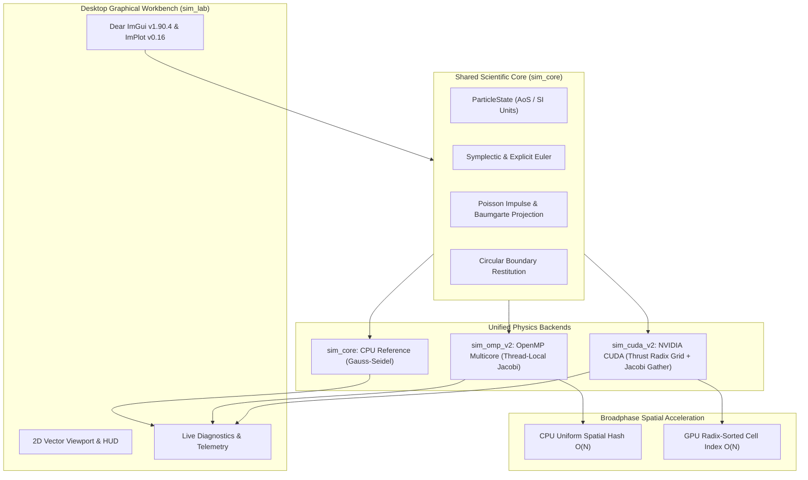
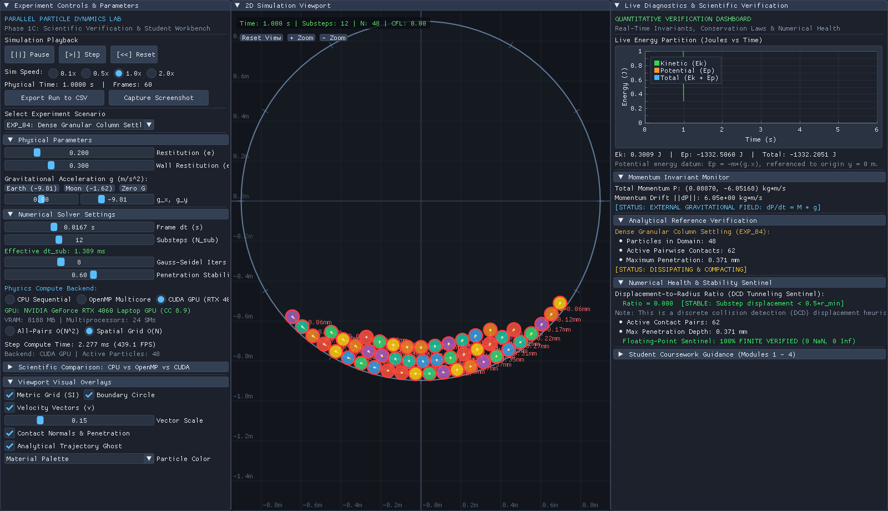
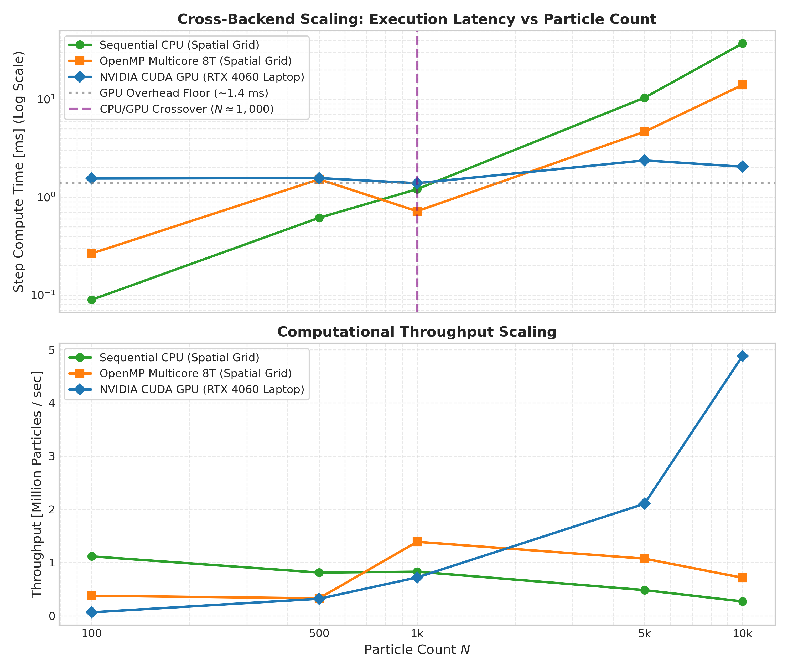

# Parallel Particle Dynamics Lab (Simulator V2)
## High-Performance Multi-Backend Particle Simulation Workbench for Computational Mechanics & HPC Education

[](LICENSE)
[](https://en.wikipedia.org/wiki/C%2B%2B17)
[](https://www.openmp.org/)
[](https://developer.nvidia.com/cuda-zone)
[](RELEASE_NOTES.md)
[](docs/PROJECT_PROGRESS.md)

---

### Table of Contents
1. [Pedagogical Mission & Platform Purpose](#pedagogical-mission--platform-purpose)
   - [Scientific Methodology: Verification vs. Validation vs. Benchmarking](#scientific-methodology-verification-vs-validation-vs-benchmarking)
2. [Multi-Backend Computing Architecture](#multi-backend-computing-architecture)
3. [Physical & Mathematical Models](#physical--mathematical-models)
4. [Interactive Laboratory Workbench (`sim_lab`)](#interactive-laboratory-workbench-sim_lab)
5. [Educational Coursework Suite](#educational-coursework-suite)
6. [HPC Performance & Benchmarking](#hpc-performance--benchmarking)
7. [Installation & Build Guide](#installation--build-guide)
8. [Quick-Start Tutorial](#quick-start-tutorial)
9. [Automated Verification Suite](#automated-verification-suite)
10. [Known Limitations & Engineering Roadmap](#known-limitations--engineering-roadmap)
11. [License & Third-Party Acknowledgments](#license--third-party-acknowledgments)

---

### Pedagogical Mission & Platform Purpose

In traditional engineering curricula, students encounter computational physics either as abstract continuous equations on paper (e.g., $m_1 v_1 + m_2 v_2 = m_1 v_1' + m_2 v_2'$) or as monolithic commercial "black-box" solvers. This division obscures the critical computational transition:

$$\text{PHYSICAL THEORY} \quad\longrightarrow\quad \text{DISCRETE NUMERICAL MODEL} \quad\longrightarrow\quad \text{PARALLEL HARDWARE ARCHITECTURE} \quad\longrightarrow\quad \text{EMPIRICAL VERIFICATION}$$

The **Parallel Particle Dynamics Lab** bridges this divide by providing an open, mathematically rigorous, multi-backend workbench. Mechanical engineering and computer science students can simultaneously evaluate numerical accuracy, conservation laws, time integration stability, and parallel scaling across:
- **Single-Threaded CPU Reference (`sim_core`):** Sequential Gauss-Seidel contact relaxation.
- **Multicore Shared-Memory CPU (`sim_omp_v2`):** OpenMP MIMD parallelism with thread-local Jacobi contact accumulation.
- **Massively Parallel GPU (`sim_cuda_v2`):** NVIDIA CUDA SIMT parallelism with double-buffered Jacobi gathering and GPU radix-sorted spatial hashing.

#### Scientific Methodology: Verification vs. Validation vs. Benchmarking

To ensure scientific credibility, the coursework and engine strictly separate three core disciplines:

1. **Numerical Verification ("Solving the equations right"):**
   - Assesses discrete algorithmic correctness, truncation error order, conservation properties, and grid recall without reference to physical reality.
   - *Laboratory implementations:* Symplectic phase-space preservation ($\det(J)=1$) vs. Explicit Euler energy drift (Lab 2), formal $O(\Delta t)$ convergence rates $p \approx 1.000$ (Lab 3), and zero-false-negative spatial hash neighbor recall (CTest 5 & 7).
2. **Physical Validation ("Solving the right equations"):**
   - Assesses whether the chosen mathematical formulation accurately represents physical mechanics within defined engineering limits.
   - *Laboratory implementations:* Poisson impulse restitution $e \in [0, 1]$ matching momentum exchange and kinetic dissipation $\Delta E_k$ (Lab 1), and Discrete Collision Detection (DCD displacement heuristic $v\Delta t/r < 0.5$ vs. Continuous Collision Detection limitations, Lab 4).
3. **HPC Benchmarking ("Hardware efficiency & scalability"):**
   - Assesses wall-clock runtime, throughput, cache effects, and parallel speedup across architectures under strictly identical physical workloads.
   - *Laboratory implementations:* Disentangling single-threaded $O(N)$ algorithmic speedup ($23.94\times$) from multicore MIMD OpenMP scaling ($4.43\times$) and GPU SIMT massive parallelism ($18.16\times$) (Lab 5).

---

### Multi-Backend Computing Architecture



---

### Physical & Mathematical Models

Every backend executes mathematically identical physical equations:

#### 1. Discrete Time Integration
- **Semi-implicit Euler-Cromer (Symplectic):**
  $$\mathbf{v}_{n+1} = \mathbf{v}_n + \mathbf{g}\,\Delta t_{\text{sub}}$$
  $$\mathbf{x}_{n+1} = \mathbf{x}_n + \mathbf{v}_{n+1}\,\Delta t_{\text{sub}}$$
  Preserves phase-space volume ($\det(J) = 1.0$), ensuring bounded total energy oscillations over long durations.
- **Explicit Forward Euler (Educational Comparison):**
  $$\mathbf{x}_{n+1} = \mathbf{x}_n + \mathbf{v}_n\,\Delta t_{\text{sub}}, \qquad \mathbf{v}_{n+1} = \mathbf{v}_n + \mathbf{g}\,\Delta t_{\text{sub}}$$
  Expands phase space ($\det(J) = 1 + \omega^2\Delta t^2 > 1$), causing artificial energy amplification.

#### 2. Momentum-Conserving Collision Response
For contact normal $\mathbf{n}_{12} = \frac{\mathbf{x}_2 - \mathbf{x}_1}{\|\mathbf{x}_2 - \mathbf{x}_1\|}$ and approach velocity $v_{\text{rel}}^- = (\mathbf{v}_1 - \mathbf{v}_2) \cdot \mathbf{n}_{12} < 0$:
$$j_n = -(1 + e)\left(\frac{m_1 m_2}{m_1 + m_2}\right) v_{\text{rel}}^- = -(1 + e)\,\mu\, v_{\text{rel}}^-$$
$$\mathbf{v}_1^+ = \mathbf{v}_1^- - \frac{j_n}{m_1}\mathbf{n}_{12}, \qquad \mathbf{v}_2^+ = \mathbf{v}_2^- + \frac{j_n}{m_2}\mathbf{n}_{12}$$

#### 3. Kinetic Energy Dissipation
$$\Delta E_k = E_k^+ - E_k^- = -\frac{1}{2}\mu\,(1 - e^2)\,(v_{\text{rel}}^-)^2$$
- $e = 1.0 \implies \Delta E_k = 0$ (exact energy conservation).
- $e < 1.0 \implies \Delta E_k < 0$ (exact physical dissipation).

#### 4. Mass-Weighted Baumgarte Positional Projection
Resolves geometric overlap $\delta = (r_1 + r_2) - d > 0$ without adding spurious velocity:
$$\Delta \mathbf{x}_1 = -\beta \left(\frac{m_2}{m_1 + m_2}\right) \delta\,\mathbf{n}_{12}, \qquad \Delta \mathbf{x}_2 = +\beta \left(\frac{m_1}{m_1 + m_2}\right) \delta\,\mathbf{n}_{12}$$

---

### Interactive Laboratory Workbench (`sim_lab`)

The application features a responsive 3-panel scientific workbench with docking persistence (`imgui.ini`):

| Viewport HUD & Granular Column Settling (CUDA GPU) | Inelastic Impact & Analytical Target Matching |
|:---:|:---:|
|  |  |

- **Live 3-Way Backend Switcher:** Toggle `[CPU Sequential]`, `[OpenMP Multicore]`, and `[CUDA GPU (RTX 4060)]` dynamically mid-simulation.
- **Hardware Telemetry:** Real-time GPU specs (Device Name, Compute Capability, SM count, VRAM), OpenMP thread sliders ($1\dots16$), and compute step time ($T_{\text{step}}$, FPS).
- **Scientific Diagnostic Gauges:** Total momentum $\mathbf{P}(t)$, kinetic energy $E_k$, potential energy $E_p$, active pairwise contact counter, max penetration depth $\delta_{\max}$, and DCD CFL tunneling sentinel.

---

### Educational Coursework Suite

Located in [`docs/coursework/`](docs/coursework/):

1. **[Lab 1: Two-Particle Impact Dynamics & Restitution](docs/coursework/LAB_01_IMPULSE_COLLISION.md):** Derive normal impulses, predict $\Delta E_k(e)$, verify linear momentum conservation $|P_x(t) - P_x(0)| < 10^{-6}\text{ kg}\cdot\text{m/s}$, and observe cross-backend invariance.
2. **[Lab 2: Symplectic vs. Explicit Integrator Stability](docs/coursework/LAB_02_INTEGRATOR_STABILITY.md):** Measure discrete truncation error $\frac{1}{2}gt\Delta t$, demonstrate phase-space preservation ($\det(J)=1$), and observe Forward Euler energy blowup.
3. **[Lab 3: Timestep Refinement & Empirical Convergence](docs/coursework/LAB_03_CONVERGENCE_STUDY.md):** Sweep $\Delta t \in \{0.04, 0.02, 0.01, 0.005, 0.0025\}\text{ s}$, tabulate $L_2 / L_\infty$ error norms, and verify empirical order $p \approx 1.000$.
4. **[Lab 4: Contact Crowding & DCD Tunneling Sentinel](docs/coursework/LAB_04_CONTACT_MECHANICS_TUNNELING.md):** Induce and cure high-speed tunneling via substepping ($\text{CFL} < 0.5$), evaluate Baumgarte stabilization, and inspect Gauss-Seidel vs Jacobi contact relaxation in dense granular columns ($N=48$).
5. **[Lab 5: HPC Parallel Computing Paradigms](docs/coursework/LAB_05_HPC_PARALLEL_SCALING.md):** Evaluate strong scaling ($T=1\dots16$), Amdahl's Law curve fits ($f \approx 85\%$), CPU cache latency vs GPU memory throughput crossovers, and algorithmic ($23.9\times$) vs hardware ($4.4\times$) acceleration.
6. **[Instructor Manual & Solutions Guide](docs/coursework/INSTRUCTOR_MANUAL.md):** Analytical solutions, model answer tables, discussion answers, and standardized 100-point grading rubrics.

---

### HPC Performance & Benchmarking

#### 1. Algorithmic Acceleration vs. Hardware Parallelism ($N = 1,024$)
Disentangling algorithmic culling from hardware multithreading:

| Mode | Algorithmic Strategy | Compute Hardware | Step Time [ms] | Speedup vs Ref | Acceleration Class |
|:---|:---|:---|:---:|:---:|:---:|
| **Mode A** | All-Pairs $O(N^2)$ | 1 CPU Core | **24.99 ms** | $1.00\times$ | Reference Baseline |
| **Mode B** | Spatial Grid $O(N)$ | 1 CPU Core | **1.04 ms** | **$23.94\times$** | **Pure Algorithmic** |
| **Mode C** | All-Pairs $O(N^2)$ | 8 OpenMP Threads | **5.64 ms** | **$4.43\times$** | **Pure Hardware Parallel** |
| **Mode D** | Spatial Grid $O(N)$ | 8 OpenMP Threads | **0.73 ms** | **$34.27\times$** | **Compound (Algo + HW)** |

*Key Pedagogical Takeaway:* Single-threaded algorithmic optimization ($23.94\times$) yields over $5\times$ more speedup than running brute-force code on 8 CPU cores ($4.43\times$).

#### 2. Cross-Backend Scaling ($N = 100 \dots 10,000$, Spatial Grid Active)
Benchmarked on **Intel Core i7-13620H** and **NVIDIA GeForce RTX 4060 Laptop GPU**:

| Particle Count $N$ | CPU Serial Grid [ms] | OpenMP 8T Grid [ms] | CUDA GPU (RTX 4060) [ms] | GPU Speedup vs CPU Grid | Throughput [Particles/sec] |
|:---:|:---:|:---:|:---:|:---:|:---:|
| **100** | $0.090$ ms | $0.266$ ms | $1.553$ ms | $0.06\times$ (CPU Faster) | $0.06\text{M p/s}$ |
| **500** | $0.616$ ms | $1.524$ ms | $1.568$ ms | $0.39\times$ (CPU Faster) | $0.32\text{M p/s}$ |
| **1,000** | $1.208$ ms | $0.720$ ms | $1.390$ ms | $0.87\times$ (**Crossover**) | $0.72\text{M p/s}$ |
| **5,000** | $10.375$ ms | $4.660$ ms | $2.376$ ms | **$4.37\times$ Faster** | $2.10\text{M p/s}$ |
| **10,000** | $37.207$ ms | $14.001$ ms | **$2.049$ ms** | **$18.16\times$ Faster** | **$4.88\text{M p/s}$** |



*Throughput Definition:* Defined as full physical frame updates per second ($S=8$ substeps per frame, 4 contact relaxation iterations per substep $\implies 32$ collision passes per frame). In terms of individual particle-substeps, peak throughput is **$39.04\times 10^6$ particle-substeps/sec**.

---

### Installation & Build Guide

#### System Requirements
- **OS:** Linux (Ubuntu 20.04+ LTS, WSL2 / WSLg supported)
- **C++ Compiler:** GCC 9+ or Clang 11+ (C++17 standard)
- **OpenMP:** Version 4.5 or newer
- **Windowing / Graphics:** OpenGL 3.3 Core, X11 or Wayland (WSLg provides `DISPLAY=:0` out of the box)
- **Optional CUDA:** NVIDIA CUDA Toolkit 12.0+ (sm_89 Ada Lovelace architecture supported). If CUDA is absent or disabled (`-DENABLE_CUDA=OFF`), the project automatically compiles as a standalone CPU/OpenMP application.
- **Python (Optional for plotting):** Python 3.8+ with `pandas`, `numpy`, `matplotlib`.

#### Ubuntu / WSL2 Dependencies Installation
```bash
sudo apt update
sudo apt install -y build-essential cmake git libgl1-mesa-dev xorg-dev
```

#### Building the Project
```bash
# 1. Standard Multi-Backend Build (Auto-detects CUDA if available)
cmake -B build -DCMAKE_BUILD_TYPE=Release
cmake --build build -j8

# 2. CPU / OpenMP Only Build (Explicitly disable CUDA)
cmake -B build_cpu -DENABLE_CUDA=OFF -DCMAKE_BUILD_TYPE=Release
cmake --build build_cpu -j8
```

---

### Quick-Start Tutorial

#### 1. Launch the Desktop Workbench
```bash
./build/sim_lab
```
- Select an experiment preset from the left panel (**EXP_01** through **EXP_04**).
- Adjust particle radii, masses, restitution $e$, or gravitational acceleration.
- Switch computing backends live using the radio buttons.

#### 2. Run Automated Scientific Experiments (Headless CSV Generation)
```bash
./build/run_experiments --out output/csv
```
Exports structured SI datasets with metadata headers to `output/csv/`.

#### 3. Generate Verification & Benchmark Plots
```bash
python3 scripts/plot_experiments.py --csv-dir output/csv --plot-dir output/plots
python3 scripts/plot_hpc_benchmarks.py
```

---

### Automated Verification Suite

Run all regression test suites via CTest:
```bash
ctest --test-dir build --output-on-failure
```

```
    Start 1: PhysicsVerification
1/9 Test #1: PhysicsVerification ...............   Passed    (14/14 tests)
    Start 2: ExperimentFrameworkVerification
2/9 Test #2: ExperimentFrameworkVerification ...   Passed    (6/6 tests)
    Start 3: CollisionLaboratoryVerification
3/9 Test #3: CollisionLaboratoryVerification ...   Passed    (7/7 tests)
    Start 4: OpenMpCorrectnessVerification
4/9 Test #4: OpenMpCorrectnessVerification .....   Passed    (46/46 tests)
    Start 5: SpatialGridVerification
5/9 Test #5: SpatialGridVerification ...........   Passed    (0 false negatives)
    Start 6: CudaCorrectnessVerification
6/9 Test #6: CudaCorrectnessVerification .......   Passed    (10/10 tests)
    Start 7: CudaSpatialGridVerification
7/9 Test #7: CudaSpatialGridVerification .......   Passed    (6 distributions)
    Start 8: CrossBackendVerification
8/9 Test #8: CrossBackendVerification ..........   Passed    (4/4 equivalences)
    Start 9: LabGuiSmokeTest
9/9 Test #9: LabGuiSmokeTest ...................   Passed    (Headless 60 frames)
```

---

### Known Limitations & Engineering Roadmap

1. **Discrete Collision Detection (DCD):** Fixed-timestep DCD with substepping is safe when $\text{CFL} < 0.5$, but extreme velocities relative to particle size can cause tunneling. Future release v2.1 will investigate Continuous Collision Detection (CCD) conservative advancement for thin geometries.
2. **2D Geometry:** The current physics engine is formulated in 2D circular domains. Roadmap Milestone M8 will explore 3D spherical extensions.
3. **Web Deployment:** Phase 4 exploratory work targets WebAssembly compilation (Emscripten) for zero-install classroom browser usage.

---

### License & Third-Party Acknowledgments

Distributed under the **MIT License**. See [`LICENSE`](LICENSE) for full details.

#### Third-Party Dependencies & Obligations
The workbench integrates the following open-source libraries via CMake FetchContent:
- **GLFW 3.3.8:** Multi-platform library for OpenGL windowing and input ([zlib/libpng License](https://www.glfw.org/license.html)). Copyright (c) 2002-2006 Marcus Geelnard, 2006-2019 Camilla Löwy.
- **Dear ImGui v1.90.4-docking:** Immediate-mode graphical user interface ([MIT License](https://github.com/ocornut/imgui/blob/master/LICENSE.txt)). Copyright (c) 2014-2024 Omar Cornut.
- **ImPlot v0.16:** Immediate-mode 2D plotting extension for Dear ImGui ([MIT License](https://github.com/epezent/implot/blob/master/LICENSE)). Copyright (c) 2020-2024 Evan Pezent.
- **stb_image_write:** Single-header image writer for scientific screenshots ([Public Domain / MIT License](https://github.com/nothings/stb)). Copyright (c) 2017 Sean Barrett.
