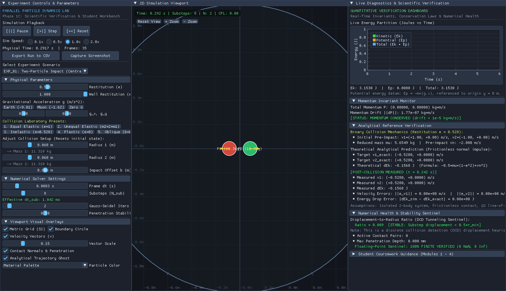
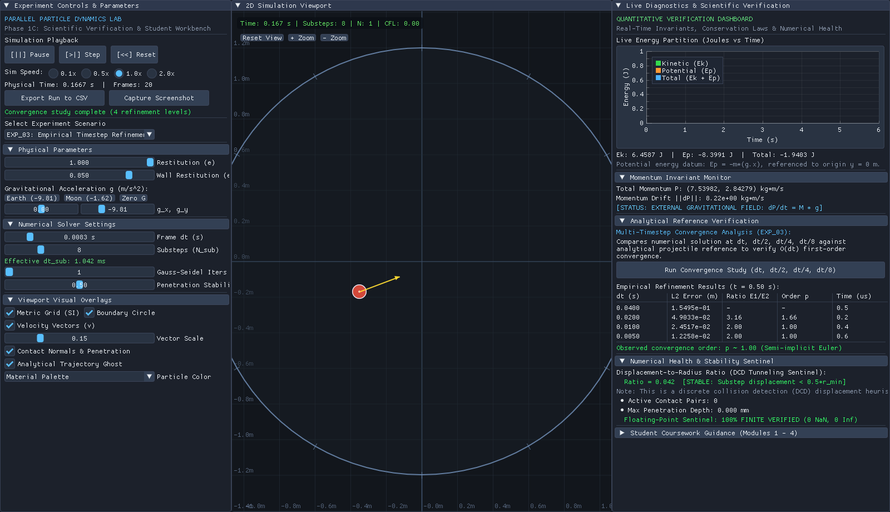
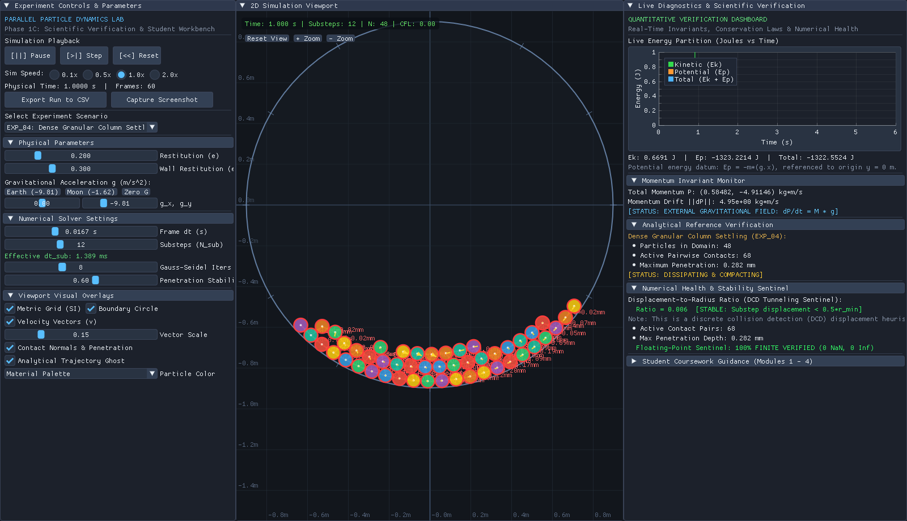

# Parallel Particle Dynamics Lab

**C++17 numerical simulation · OpenMP multicore computing · NVIDIA CUDA · Scientific verification**

An interactive **2D particle-dynamics engineering prototype** for studying how physical equations become numerical algorithms—and how those algorithms behave on a sequential CPU, a multicore CPU, and an NVIDIA GPU.


> **Project status:** Published educational/portfolio prototype (v2 release candidate). The implementation is verified for the documented test scenarios and hardware, **not** a research-validated general-purpose physics engine.

## What this project demonstrates

| Engineering area | Implementation / experiment |
| --- | --- |
| **Dynamics and contact mechanics** | Elastic, inelastic, unequal-mass, and oblique impacts; impulse-based normal contact and circular boundaries |
| **Numerical methods** | Explicit and semi-implicit Euler; analytical references and timestep-refinement studies |
| **Iterative contact resolution** | Sequential Gauss–Seidel-style updates versus parallel Jacobi-style accumulation; penetration stabilization |
| **High-performance computing** | Sequential C++, OpenMP multithreading, optional CUDA kernels, and spatial-grid broad-phase collision detection |
| **Scientific software** | Dear ImGui/ImPlot visualization, energy and momentum diagnostics, automated tests, CSV export, and plotting scripts |

The goal is to connect **mathematical theory → C++ implementation → simulation → measured error → engineering interpretation**.

## See it in action

| Collision and conservation | Numerical convergence | Dense granular contacts |
| :---: | :---: | :---: |
|  |  |  |

Additional verified screenshots: [gravity](output/screenshots/gui_exp02_ballistic_gravity.png) · [OpenMP collision](output/screenshots/gui_exp01_openmp_collision.png) · [CUDA granular](output/screenshots/gui_exp04_cuda_gpu.png) · [OpenMP granular](output/screenshots/gui_exp04_openmp_multicore.png).

### Five-minute walkthrough

1. Launch `sim_lab` and select **Two-Particle Impact**. Choose an elastic collision, then vary restitution and inspect post-impact velocities and kinetic energy.
2. Switch between **sequential CPU** and **OpenMP**; use **CUDA** only on compatible NVIDIA hardware.
3. Select **Ballistic Gravity** and compare the numerical trajectory with the analytical prediction **before wall contact**.
4. Open the **Timestep Convergence** experiment and run the refinement study.
5. Select **Dense Granular Column** to examine multiple simultaneous contacts and penetration diagnostics.

The contact-update algorithms differ across backends: **dense, many-body trajectories are not guaranteed to match particle-for-particle**. The comparisons instead use analytical cases and appropriate numerical metrics.

## Quick start

**Verified platform:** Ubuntu 24.04 in WSL2/WSLg; GCC 13.3; CMake 3.28.3; OpenMP 4.5. The GUI requires an OpenGL 3.3 display environment. Native Windows and macOS builds have not been verified.

```bash
sudo apt update
sudo apt install -y build-essential cmake git libgl1-mesa-dev xorg-dev

git clone https://github.com/Devansh-Mishra-30/cuda-particle-simulation.git
cd cuda-particle-simulation

# Recommended: CPU/OpenMP desktop build (no NVIDIA GPU needed)
cmake -S . -B build -DCMAKE_BUILD_TYPE=Release -DENABLE_CUDA=OFF
cmake --build build -j8
ctest --test-dir build --output-on-failure
./build/sim_lab
```

For **command-line experiments without the desktop GUI**:

```bash
cmake -S . -B build_cli -DCMAKE_BUILD_TYPE=Release \
  -DENABLE_CUDA=OFF -DBUILD_LAB_GUI=OFF
cmake --build build_cli -j8
ctest --test-dir build_cli --output-on-failure
./build_cli/run_experiments --out output/csv
```

For **CUDA** (tested on an NVIDIA RTX 4060 Laptop GPU with CUDA Toolkit 12.0, compute capability 8.9):

```bash
cmake -S . -B build_cuda -DCMAKE_BUILD_TYPE=Release -DENABLE_CUDA=ON
cmake --build build_cuda -j8
ctest --test-dir build_cuda --output-on-failure
./build_cuda/sim_lab
```

The current CUDA build configuration targets `sm_89` specifically. Other architectures have **not** been release-tested. Desktop dependencies (GLFW, Dear ImGui, and ImPlot) are fetched during CMake configuration; the first configure requires network access.

## Under the hood

### Physics model

For two particles in frictionless normal contact, the impulse magnitude is

$$
j=-\frac{(1+e)v_n}{m_1^{-1}+m_2^{-1}},
$$

where $e$ is the coefficient of restitution and $v_n$ is the approaching relative normal velocity, under the solver's sign convention.

Under constant acceleration, the default **semi-implicit Euler** method updates velocity before position:

$$
\mathbf v_{n+1}=\mathbf v_n+\mathbf g\,\Delta t,
\qquad
\mathbf x_{n+1}=\mathbf x_n+\mathbf v_{n+1}\,\Delta t.
$$

The project also implements **explicit (forward) Euler** and provides refinement experiments to examine first-order position-error behavior for smooth motion.

### Compute backends

| Backend | Contact update strategy | Main purpose |
| --- | --- | --- |
| `sim_core/` | Sequential, in-place Gauss–Seidel-style | Reference implementation and analytical tests |
| `sim_omp_v2/` | OpenMP, thread-local Jacobi-style accumulation | Multicore implementation and scaling studies |
| `sim_cuda_v2/` | CUDA, double-buffered Jacobi-style updates | GPU implementation and numerical comparisons |

Uniform spatial grids reduce collision *candidate discovery* in suitable particle distributions; they do not guarantee constant work for arbitrarily dense scenes. Reported performance data are hardware-, algorithm-, and workload-specific—not universal GPU speedup claims.

## Verification evidence

An engineering audit on **November 1, 2026** reported these results on the documented WSL2/RTX 4060 environment:

| Build / test scope | Reported result |
| --- | ---: |
| CUDA-enabled build | **10/10** CTest suites passed |
| CPU/OpenMP desktop build | **7/7** CTest suites passed |
| CPU/OpenMP CLI-only build | **6/6** CTest suites passed |
| Core physics checks | **14/14** passed |
| Collision acceptance checks | **7/7** passed |
| OpenMP checks across 1–16 threads | **46/46** passed |
| CUDA correctness checks | **10/10** passed |
| Cross-backend scenarios | **4/4** passed |

Five non-empty CSV exports were also generated. These results describe **tested configurations and scenarios**, not universal physical accuracy. Reproduce locally with `ctest` and inspect the source in [`tests/`](tests/).

Explore [sample CSV files](output/csv/), [plots](output/plots/), [release notes](RELEASE_NOTES.md), and the [engineering limitations](docs/verification/KNOWN_LIMITATIONS.md).

## Repository guide

| Folder | Contents |
| --- | --- |
| [`sim_core/`](sim_core/) | Shared physical types, integration, contact and boundary logic, diagnostics |
| [`sim_omp_v2/`](sim_omp_v2/) | Multicore solver and spatial-grid broad phase |
| [`sim_cuda_v2/`](sim_cuda_v2/) | CUDA solver and GPU spatial grid |
| [`lab_gui/`](lab_gui/) | GLFW / Dear ImGui / ImPlot desktop interface |
| [`experiments/`](experiments/) | Reproducible experiment runners and numerical audit |
| [`tests/`](tests/) | Regression, analytical, and cross-backend checks |
| [`docs/coursework/`](docs/coursework/) | Five guided educational laboratory modules |
| [`output/`](output/) | Example screenshots, CSV data, and historical benchmark plots |
| [`2D-particle-sim/`](2D-particle-sim/) | **Legacy v1** SFML-based CPU/GPU prototype and historical measurements; not the current v2 implementation |

For guided studies, see the [experiment guide](docs/experiments/EXPERIMENT_GUIDE.md) and [educational labs](docs/coursework/). Some historical engineering reports retain milestone-specific terminology and benchmark results; the current README and release notes define the public v2 claims.

## Scope and known limitations

- **2D circular particles**, frictionless normal contacts, no spin or rotational dynamics.
- **Discrete collision detection** can miss impacts at excessive travel per substep; the displayed displacement ratio is a heuristic, not a guarantee.
- **Gauss–Seidel vs. Jacobi** update ordering can produce different dense-contact trajectories.
- **CUDA tested on `sm_89`** only; portability to other GPU architectures is unverified.
- **GUI tested primarily on Linux/WSLg**; native platform support is not guaranteed.
- **Historical performance plots** are examples from specific hardware and benchmark configurations, not transferable acceleration guarantees.
- Unattended WSLg screenshot mode produced blank captures during an audit; the checked-in application screenshots were visually inspected.

This project demonstrates numerical simulation engineering and HPC concepts; it is **not** intended for safety-critical calculations or validation of real granular-material behavior.

## License

[MIT License](LICENSE), with third-party notices in the same file. Verify the redistribution rights of any **legacy** bundled assets separately before reuse.
