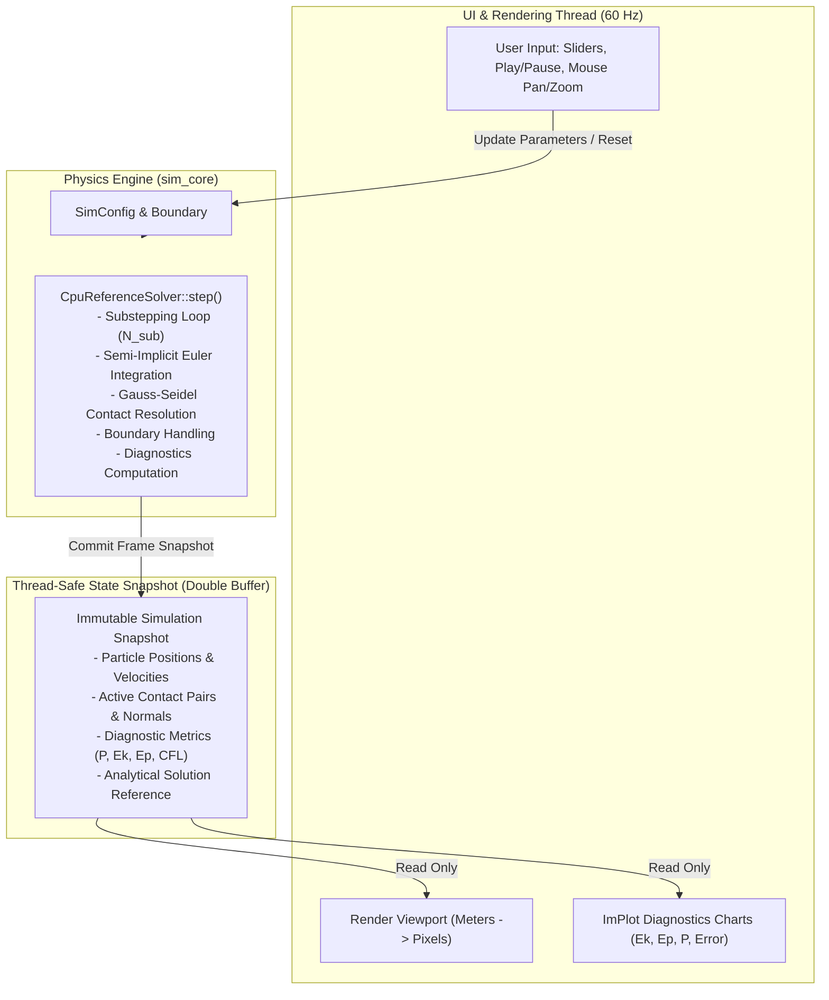

# Parallel Particle Dynamics Lab: Interactive Scientific Lab Specification
## Software Architecture, UI Design, and Numerical Diagnostics Interface

**Document Version:** 1.0.0 (Phase 1A.5 Educational Architecture)
**Target Milestone:** Educational Graphical Interface (Phase 1B / Phase 3)
**Core Domain:** Mechanical Engineering Education & Numerical Dynamics Verification

---

## 1. Executive Summary & Educational Intent

The **Parallel Particle Dynamics Lab** is an open-source, interactive desktop application designed for undergraduate and graduate mechanical engineering students, dynamics instructors, and computational researchers.

Unlike conventional physics sandboxes that prioritize entertainment, visual flashiness, or game-style approximations, the Parallel Particle Dynamics Lab prioritizes **scientific rigor, numerical transparency, and quantitative verification**. Every visual element on screen is backed by explicit SI physical units, observable conservation laws, transparent numerical algorithms, and real-time analytical verification overlays.

```
+---------------------------------------------------------------------------------------------------+
|                                  PARALLEL PARTICLE DYNAMICS LAB                                   |
+--------------------------+------------------------------------------+-----------------------------+
|       LEFT PANEL         |               CENTER PANEL               |         RIGHT PANEL         |
|  Controls & Parameters   |       2D Simulation Viewport             |    Live Diagnostics         |
|                          |                                          |    & Verification Plots     |
| - Experiment Selector    | - Real-time SI Canvas (Meters)           | - Live Energy Partition     |
|   * EXP_01 Collision     | - Pan, Zoom, Coordinate Grid             |   (Ek, Ep, E_total)         |
|   * EXP_02 Gravity       | - Velocity Vectors (v)                   | - Momentum Invariant        |
|   * EXP_03 Convergence   | - Contact Normal Vectors (n)             |   Drift Monitor             |
|   * EXP_04 Dense Packing | - Particle Color-coding (v, m, Ek)       | - Real-Time Error vs        |
| - Physical Parameters    | - Circular Boundary Overlay              |   Analytical Solution       |
|   (e, m1, m2, r, g, rho) | - Coordinate Separation (Pixels vs SI)   | - Numerical Stability Panel |
| - Numerical Config       |                                          |   * CFL number              |
|   (dt, substeps, iters)  |                                          |   * Active contact count    |
| - Playback & Export      |                                          |   * Max penetration depth   |
|   (Play, Pause, Step,    |                                          |   * NaN/Inf Sentinel        |
|    Reset, Export CSV)    |                                          | - Convergence Inspector     |
+--------------------------+------------------------------------------+-----------------------------+
```

---

## 2. Three-Panel Interface Architecture

### 2.1 Left Panel: Experiment Controls & Physical Parameters

The Left Panel provides precise control over the physical scenario and numerical solver configurations:

1. **Experiment Selector:**
   - Dropdown menu of predefined educational experiments:
     - `EXP_01: Two-Particle Impact (Central & Oblique)`
     - `EXP_02: Ballistic Flight & Free Fall Trajectories`
     - `EXP_03: Empirical Timestep Refinement Study`
     - `EXP_04: Dense Granular Column & Contact Equilibrium`
     - `EXP_CUSTOM: User-Defined Particle Setup`

2. **Physical Parameter Sliders & Numeric Inputs (with SI Units):**
   - **Coefficient of Restitution ($e$):** Continuous slider from $0.000$ (completely plastic) to $1.000$ (perfectly elastic), with warning indicator if $e > 1.0$ (non-physical energy injection).
   - **Particle Radii ($r_1, r_2$):** Range $[0.005, 0.200]\,\text{m}$ (5 mm to 20 cm).
   - **Material Density ($\rho$):** Input in $\text{kg/m}^2$ (default: $1000\,\text{kg/m}^2$).
   - **Particle Masses ($m_1, m_2$):** Automatically calculated as $m_i = \pi \rho r_i^2$ with explicit display in $\text{kg}$.
   - **Gravitational Acceleration ($\mathbf{g}$):** Independent controls for $g_x$ and $g_y$ in $\text{m/s}^2$ (presets for Earth $9.80665\,\text{m/s}^2$, Moon $1.62\,\text{m/s}^2$, Zero Gravity).
   - **Initial Velocities ($\mathbf{v}_1, \mathbf{v}_2$):** Vector input in $\text{m/s}$.

3. **Numerical Integration Controls:**
   - **Timestep Size ($\Delta t$):** Selector from $0.001\,\text{s}$ to $0.050\,\text{s}$.
   - **Substeps per Frame:** Slider $[1, 32]$ (enabling high-frequency contact resolution).
   - **Contact Solver Iterations:** Gauss-Seidel stabilization iterations $[1, 20]$.
   - **Effective Substep ($\Delta t_{\text{sub}} = \Delta t / N_{\text{sub}}$):** Live display in milliseconds.

4. **Simulation Playback & Data Export:**
   - **Playback Buttons:** `[Play]`, `[Pause]`, `[Step Single Frame]`, `[Reset Initial]`.
   - **Simulation Clock:** Current physical time $t$ in seconds and total integrated step count $N$.
   - **`[Export CSV]` Button:** Instantly dumps complete high-precision time-series data of particle states, energies, and error metrics to disk.

---

### 2.2 Center Panel: Scientific 2D Simulation Viewport

The Center Panel renders the live physical dynamics with scientific visualization overlays:

1. **Strict Coordinate Separation:**
   - **Physical Simulation Coordinates (SI Units):** All physics equations, particle positions, velocities, and radii operate strictly in meters ($\text{m}$) and seconds ($\text{s}$). The center of the container is $(0, 0)\,\text{m}$.
   - **Viewport Camera Transform:**
     $$\mathbf{x}_{\text{screen}} = \mathbf{x}_{\text{origin}} + \mathbf{S} \cdot (\mathbf{x}_{\text{world}} - \mathbf{x}_{\text{camera}})$$
     where $\mathbf{S} = \text{diag}(s_x, -s_y)$ scales meters to pixels (with y-inversion so that positive y points upwards).
   - **Interactive Navigation:** Mouse drag to pan camera; scroll wheel to zoom smoothly without disturbing physical simulation state.

2. **Scientific Visual Overlays (Toggleable by Student):**
   - **Metric Grid:** Metric background grid with dynamic grid spacing ($0.1\,\text{m}, 0.5\,\text{m}, 1.0\,\text{m}$) and numerical coordinate markings.
   - **Velocity Vectors:** Rendered as directed arrows originating from particle centers with magnitude proportional to $\|\mathbf{v}\|$ (in $\text{m/s}$) and arrowhead indicating heading.
   - **Contact Normal & Penetration Overlays:** During contact, a red line segment displays the contact normal $\mathbf{n}_{ij}$ and highlighted contact patch illustrates the penetration depth $\delta$.
   - **Analytical Trajectory Ghost:** In ballistic motion, a faint dashed curve displays the analytical reference trajectory $\mathbf{x}_{\text{exact}}(t)$, allowing immediate visual detection of numerical error.
   - **Particle Color-Coding Modes:**
     - Uniform Material Color
     - Kinetic Energy Heatmap (blue = slow, red = high speed)
     - Contact State (green = free, orange = single contact, red = multi-contact clamping)
     - Particle Mass (saturation proportional to $m_i$)

3. **Boundary Representation:**
   - Smoothly rendered circular outer boundary of radius $R_{\text{boundary}}$ with radial tick marks.

---

### 2.3 Right Panel: Live Diagnostics & Verification Dashboard

The Right Panel connects the visual simulation to quantitative verification through real-time charts and invariant monitors:

1. **Live Energy Partition Graph:**
   - Continuous scrolling time-series plot displaying:
     - Kinetic Energy $E_k(t)$ (green line)
     - Potential Energy $E_p(t)$ (orange line)
     - Total Mechanical Energy $E_{\text{total}}(t) = E_k + E_p$ (thick blue line)
   - Demonstrates energy dissipation during inelastic impact ($\Delta E_k < 0$) and reveals symplectic energy conservation vs naive Euler divergence.

2. **Momentum Invariant Monitor:**
   - Real-time display of total linear momentum components $P_x(t), P_y(t)$ in $\text{kg}\cdot\text{m/s}$.
   - **Numerical Drift Gauge:**
     $$\Delta P = \|\mathbf{P}(t) - \mathbf{P}(0)\|$$
     Displays green status indicator when $\Delta P < 10^{-5}\,\text{kg}\cdot\text{m/s}$, and red warning if external boundary interactions or parallel race conditions introduce momentum error.

3. **Real-Time Error vs. Analytical Solution:**
   - In verified scenarios (two-body collision, free fall):
     - Displays current absolute position error $\|\mathbf{x}_{\text{sim}} - \mathbf{x}_{\text{exact}}\|$ in millimeters.
     - Displays current velocity error $\|\mathbf{v}_{\text{sim}} - \mathbf{v}_{\text{exact}}\|$ in $\text{m/s}$.
     - Displays theoretical vs actual energy drop $\Delta E_k$.

4. **Numerical Health & Stability Sentinel:**
   - **Courant-Friedrichs-Lewy (CFL) Ratio:**
     $$\text{CFL} = \frac{v_{\max} \Delta t_{\text{sub}}}{r_{\min}}$$
     - Green: $\text{CFL} < 0.5$ (Safe, discrete collision detection reliable).
     - Yellow: $0.5 \le \text{CFL} < 1.0$ (Marginal, substepping recommended).
     - Red: $\text{CFL} \ge 1.0$ (High risk of particle tunneling!).
   - **Active Contacts Count:** Number of interacting particle pairs in current substep.
   - **Maximum Penetration Depth ($\delta_{\max}$):** Displayed in millimeters with ratio $\delta_{\max} / r_{\min}$.
   - **Zero NaN/Inf Guarantee:** Immediate flashing alert if any state variable becomes non-finite.

---

## 3. Technology Stack Evaluation for Educational Deployment

To ensure maximum portability across student hardware (Windows, macOS, Ubuntu/WSL2), minimal build dependencies, and zero proprietary licenses, three candidate architectures were evaluated:

| Criterion | Option A: GLFW 3.3 + OpenGL + Dear ImGui (C++) | Option B: WebAssembly (Wasm) + WebGL 2 + Preact / HTML5 Canvas | Option C: SDL2 + Cairo 2D (C++) |
|:---|:---:|:---:|:---:|
| **Language & Core Reuse** | Direct link with C++17 `sim_core` static library | Compile `sim_core` via Emscripten; JS UI | Direct link with C++17 `sim_core` |
| **Cross-Platform Support** | High (native on Linux, Windows, macOS, WSL2 with WSLg) | Maximum (runs in any web browser without installation) | High (native on desktop platforms) |
| **Rendering Performance** | Excellent (hardware accelerated instanced rendering, $10^5+$ particles) | Good (WebGL 2 instancing handles $10^4+$ particles at 60 FPS) | Moderate (software/2D accelerated; bottlenecks at $10^3$ particles) |
| **Interactive UI Components** | Exceptional (Dear ImGui has native sliders, plots via `ImPlot`, dials) | Exceptional (modern HTML5 / React UI ecosystem) | Fair (requires external UI library or custom widgets) |
| **Build Complexity for Students** | Single CMake configure (`cmake -B build && cmake --build build`) | Web browser instant launch or `emcmake` build | CMake with SDL2/Cairo system packages |
| **Zero-Installation Feasibility** | Prebuilt standalone binary ($\approx 10\,\text{MB}$) | Browser URL (zero student installation required) | Standalone binary with dynamic libraries |

### Recommendation:
1. **Primary Desktop Target (Phase 1B): GLFW 3.3 + Modern OpenGL + Dear ImGui + ImPlot.**
   - Keeps the entire stack in modern, high-performance C++17.
   - Reuses `sim_core` directly with zero glue code or binding overhead.
   - `ImPlot` provides built-in, GPU-accelerated scientific real-time time-series plots, error bars, and logarithmic axes.
   - Lightweight standalone executable with no external runtime dependencies.
2. **Secondary Web Deployment (Phase 4): WebAssembly via Emscripten.**
   - Compile `sim_core` and the Dear ImGui frontend to WebAssembly (`sim_lab.html`) for classroom environments where students cannot install native compilers.

---

## 4. Software Architecture and Dataflow Pipeline

The GUI must never corrupt or race with the physical simulation engine. The dataflow operates with clean decoupling:



### 4.1 Decoupled Stepping Logic
- If `state == PAUSED`: Viewport renders the current static snapshot; user can step single frame or adjust parameters.
- If `state == RUNNING`: The simulation engine executes $N_{\text{sub}}$ steps per display frame to advance physical time by $\Delta t_{\text{frame}} = 1/60\,\text{s}$.
- If computational time exceeds frame budget, simulation runs at fixed physical timestep with adaptive rendering skip to preserve numerical accuracy over wall-clock synchrony.

---

## 5. Educational Lab Exercises & Student Assignments

The interactive environment is accompanied by guided lab modules designed for engineering coursework:

### Module 1: The Elasticity Parameter and Kinetic Energy Partition
- **Student Objective:** Predict and verify the post-collision velocity of two particles with $m_2 = 2 m_1$ as $e$ varies from $1.0$ to $0.0$.
- **Task:** Derive $\Delta E_k(e)$ theoretically and confirm that the simulation's live $E_k$ drop matches theoretical predictions within $0.01\%$.

### Module 2: Investigating Symplectic vs Explicit Integration
- **Student Objective:** Observe the breakdown of energy conservation in non-symplectic integrators.
- **Task:** Toggle between Semi-implicit Euler and Forward Euler in gravitational flight. Measure the artificial rate of energy growth $\Delta E / \Delta t$ under Forward Euler and explain why Semi-implicit Euler remains bounded.

### Module 3: Measuring the Empirical Order of Convergence
- **Student Objective:** Compute empirical order $p$ from live simulation runs.
- **Task:** Record global $L_\infty$ position error for $\Delta t = [0.04, 0.02, 0.01, 0.005]\,\text{s}$. Plot $\ln(\text{error})$ vs $\ln(\Delta t)$ using the built-in ImPlot tool and extract the slope to prove first-order convergence.

### Module 4: High-Speed Tunneling and the CFL Condition
- **Student Objective:** Understand the failure mode of discrete collision detection (DCD).
- **Task:** Increase particle velocity until $\text{CFL} > 1.5$ with 1 substep. Observe particles tunneling through one another or through the boundary. Gradually increase substeps until $\text{CFL} < 0.5$ to restore correct collision response.

---

## 6. Implementation Milestones

- **Phase 1A.5 (Current):** Headless C++ reference solver, experiment harness, structured CSV export, regression test suite, and scientific plotting utilities (**Complete**).
- **Phase 1B:** Interactive GLFW + Dear ImGui desktop application implementing the 3-panel layout, real-time vector rendering, and ImPlot diagnostic charts.
- **Phase 2:** Multi-threaded OpenMP V2 backend with thread-safe contact graph coloring.
- **Phase 3:** CUDA V2 GPU backend with uniform spatial grid, atomic-free contact updates, and live GPU-to-display interop.
- **Phase 4:** WebAssembly browser deployment for universal classroom access.
