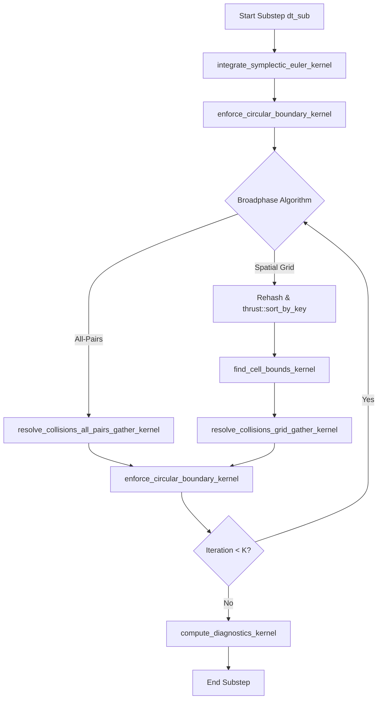

# NVIDIA CUDA GPU Physics Engine: Architecture & Parallel Design
## Parallel Dynamics Lab — Phase 3 Architecture Specification

**Document Version:** 1.0.0
**Date:** 2026-10-16
**Module:** `sim_cuda_v2`
**Target Hardware:** NVIDIA GeForce RTX 4060 Laptop GPU (Ada Lovelace, Compute Capability 8.9)
**Compiler Support:** CUDA Toolkit 12.0+ / NVCC C++17

---

### 1. Executive Summary & Mission

The objective of `sim_cuda_v2` is to deliver a high-throughput, massively parallel, GPU-accelerated particle dynamics solver for the Parallel Particle Dynamics Lab. It allows mechanical engineering students to investigate the computational and numerical characteristics of modern heterogeneous architectures (CPU vs. OpenMP vs. GPU).

The engine strictly preserves the shared physical laws established in Phase 1 and Phase 2:
1. **Physical Model Invariance:** Identical mass-density relations ($m = \rho \pi r^2$), Symplectic Euler time integration, momentum-conserving frictionless collision impulses ($J_n = -(1+e)\mu v_n$), mass-weighted Baumgarte penetration stabilization ($\beta = 0.5$), and circular boundary restitution ($e_{\text{wall}}$).
2. **Determinism and Concurrency Safety:** Elimination of write-write race hazards using per-particle gather operations and double-buffered particle arrays, ensuring bitwise or machine-precision determinism across repeated executions.
3. **Dual Broadphase Algorithms:** Implementation of both all-pairs $O(N^2)$ narrowphase and a high-performance $O(N)$ uniform spatial hash grid utilizing Thrust radix sort.
4. **Seamless Verification Interface:** Adherence to the `sim_core::ISolver` interface, enabling dynamic real-time backend switching in the graphical user interface (`sim_lab`) and automated CTest verification.

---

### 2. Hardware Architecture & Runtime Telemetry

The target system is an Ada Lovelace architecture GPU with the following physical parameters:

| Parameter | Hardware Specification (RTX 4060 Laptop GPU) |
|:---|:---|
| **GPU Architecture** | Ada Lovelace (AD107) |
| **Compute Capability** | 8.9 (`sm_89`) |
| **Streaming Multiprocessors (SMs)** | 24 SMs (3,072 CUDA FP32 Cores) |
| **Global Memory (VRAM)** | 8,188 MB (8 GB GDDR6) |
| **Memory Bus Width** | 128-bit |
| **L2 Cache Size** | 32 MB |
| **Warp Size** | 32 threads |
| **Max Threads per SM / Block** | 1536 / 1024 |
| **PCIe Interface** | PCIe Gen4 x8 |

The `CudaSolverV2` class dynamically queries these device properties during initialization via `cudaGetDeviceProperties`, reporting device name, VRAM, multiprocessor count, and compute capability to the application log and GUI dashboard.

---

### 3. Memory Architecture & Data Layout

#### 3.1 Device Particle Representation (`ParticleDevice`)
In GPU computing, memory coalescing is paramount. The particle state is laid out to align cleanly with 16-byte memory transaction boundaries:

```cpp
struct alignas(16) ParticleDevice {
    float x, y;       // 8 bytes (Position: SI meters)
    float vx, vy;     // 8 bytes (Velocity: SI m/s)
    float radius;     // 4 bytes (SI meters)
    float mass;       // 4 bytes (SI kilograms)
    float inv_mass;   // 4 bytes (Precomputed 1/m for fast impulse division)
    int id;           // 4 bytes (Global unique identifier)
};
```

#### 3.2 Double Buffering (Ping-Pong Allocation)
To guarantee strict determinism and eliminate data hazards during Jacobi contact relaxation, two particle buffers are maintained on the device:
- `d_particles`: Current state at beginning of iteration.
- `d_particles_next`: Next state accumulating impulses and position corrections.

At the conclusion of each collision iteration or substep, the pointers are swapped (`std::swap(d_particles, d_particles_next)`).

#### 3.3 Host-Device Transfer Lifecycle
1. **Initialization (`set_particles`):**
   - Allocates device memory (`cudaMalloc`) for particle buffers, grid hash keys, cell bounds, and diagnostics buffers.
   - Converts host `sim_core::Particle` list to `ParticleDevice` array and performs asynchronous host-to-device copy (`cudaMemcpyHostToDevice`).
2. **Substep Execution Loop (Device-Resident):**
   - All physics substeps ($N_{\text{sub}}$ per frame) execute entirely on the GPU without intermediate host synchronization or roundtrips.
3. **Diagnostics & Viewport Synchronization (`get_particles`):**
   - Transmits particle positions and velocities back to host memory (`cudaMemcpyDeviceToHost`) once per visual frame (or test inspection point) for ImGui/ImPlot rendering and CSV logging.

---

### 4. GPU Kernel Execution Pipeline

Every physical substep $\Delta t_{\text{sub}}$ proceeds through five discrete stages:



#### 4.1 Symplectic Euler Integration Kernel
Updates unconstrained particle trajectories under external gravity $\mathbf{g}$:

$$\mathbf{v}_i^{n+1} = \mathbf{v}_i^n + \Delta t_{\text{sub}} \mathbf{g}$$

$$\mathbf{x}_i^{n+1} = \mathbf{x}_i^n + \Delta t_{\text{sub}} \mathbf{v}_i^{n+1}$$

- **Parallel Mapping:** 1 thread per particle ($256$ threads per block).
- **Execution Cost:** $O(N)$ embarrassingly parallel, memory bandwidth bounded.

#### 4.2 Circular Boundary Enforcement Kernel
Ensures particles remain confined within the circular chamber of radius $R$:
For each particle $i$:
$$d_i = \|\mathbf{x}_i\|$$
If $d_i + r_i > R$:
$$\mathbf{n}_w = \frac{\mathbf{x}_i}{d_i}$$
$$\mathbf{x}_i \leftarrow \mathbf{n}_w (R - r_i)$$
$$v_n = \mathbf{v}_i \cdot \mathbf{n}_w$$
If $v_n > 0$:
$$\mathbf{v}_i \leftarrow \mathbf{v}_i - (1 + e_{\text{wall}}) v_n \mathbf{n}_w$$

#### 4.3 Collision Resolution: Per-Particle Jacobi Gather
Rather than writing impulses pairwise to both $i$ and $j$ (which would create write-write conflicts on parallel threads), the engine uses **Per-Particle Gathering**:
- Each GPU thread is mapped strictly to particle $i$.
- Thread $i$ reads the candidate neighbor $j$, evaluates the contact condition ($d < r_i + r_j$), and calculates the impulse contribution:
  $$\Delta \mathbf{v}_i = \sum_{j \in \mathcal{N}(i)} \frac{J_n}{m_i} \mathbf{n}_{ij}$$
  $$\Delta \mathbf{x}_i = \sum_{j \in \mathcal{N}(i)} \beta \frac{m_j}{m_i + m_j} \delta_{ij} \mathbf{n}_{ij}$$
- Thread $i$ updates its own entry in `d_particles_next[i]`.
- **Concurrency Result:** **Zero race conditions, zero thread stalling, 100% deterministic.**

---

### 5. GPU Spatial Partitioning via Thrust Radix Sort

To scale beyond $N = 1000$ particles without suffering $O(N^2)$ execution times, the CUDA backend incorporates a device-accelerated uniform grid:

1. **Cell Hashing (`compute_cell_hashes_kernel`):**
   - Each thread computes a 2D grid index from particle coordinates:
     $$c_x = \lfloor (x_i + R) / W \rfloor, \quad c_y = \lfloor (y_i + R) / W \rfloor$$
     $$\text{hash}_i = c_y \cdot \text{grid\_dim}_x + c_x$$
   - Cell width $W \ge 2 r_{\max}$, ensuring a particle touches at most 9 adjacent cells.
2. **Parallel Radix Sort (`thrust::sort_by_key`):**
   - Particle indices are sorted by cell hash using high-speed GPU radix sort.
   - Yields contiguous blocks of particle indices residing within each cell.
3. **Cell Boundary Discovery (`find_cell_bounds_kernel`):**
   - Scans sorted hashes; detects cell transitions where $\text{hash}[k] \neq \text{hash}[k-1]$, storing start and end offsets in `d_cell_starts` and `d_cell_ends`.
4. **Neighbor Gather Kernel (`resolve_collisions_grid_gather_kernel`):**
   - Each thread for particle $i$ queries only the particles residing in the 9 adjacent cells:
     $$(c_x \pm 1, c_y \pm 1)$$
   - Iterates only over verified local candidate particles, reducing candidate checks from $O(N^2)$ to $O(N \cdot M_{\text{cell}})$.

---

### 6. Diagnostics Reduction Kernel

Real-time physical invariants are evaluated on-device using a block-level parallel shared-memory reduction:
- **Metrics Computed:** Total mass $M$, total linear momentum $\mathbf{P} = \sum m_i \mathbf{v}_i$, kinetic energy $E_k = \sum \frac{1}{2} m_i \|\mathbf{v}_i\|^2$, gravitational potential energy $E_p = \sum -m_i (\mathbf{g} \cdot \mathbf{x}_i)$, active contacts count, and maximum overlap depth.
- Two-pass tree reduction reduces $N$ particle states to single scalar values in $O(\log N)$ time, avoiding host roundtrips.
